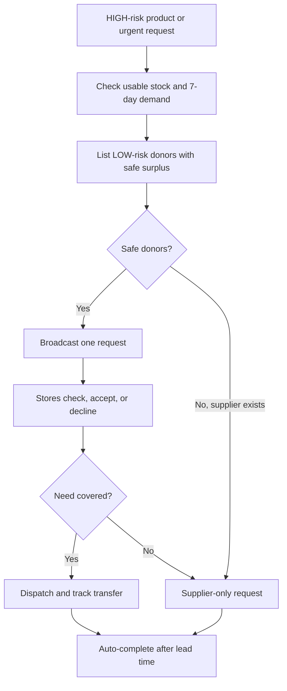

# Stoqvia

AI-powered inventory risk detection and inter-store fulfilment coordination for multi-store retailers.

Stoqvia is a shared coordination layer for store teams. It brings demand-based risk detection, donor-store discovery, request broadcasting, stock verification, transfer tracking, and supplier fallback into one governed workflow, so employees spend less time on calls and more time on the shop floor.

## Product overview

Stoqvia is an inventory coordination product for multi-store retail networks. Store administrators log in to their own store, see which products are at risk over the next seven days, and raise a single fulfilment request instead of ringing neighbouring stores one by one.

It is designed for store managers and inventory coordinators who already know the operational problem: stock is fragmented across locations, shortage checks are slow, and the same request is explained repeatedly. Stoqvia connects four parts of that job: **prediction** (7-day demand and risk), **coordination** (broadcast requests and store responses), **fulfilment** (dispatch, in-transit tracking, and completion), and **automation** (due transfers complete without a manual chase).

The current repository is a working four-store Adelaide demonstration (Adelaide CBD, Marion, Mile End, and Modbury) with a React store console, a FastAPI backend, MongoDB, a LightGBM demand model, and a read-only Copilot over local Ollama.

## The problem

Inter-store replenishment often still runs on phone calls and local knowledge. When a store is short, an employee typically checks their own system, then calls other locations, waits for someone to confirm stock, records who said yes or no, and follows up on whether stock actually moved. If no store can help, they start a separate supplier conversation.

That process creates delay and duplicated work:

- Inventory truth is split across stores, so donor discovery is slow.
- The same shortage is explained on every call.
- Stock is verified by whoever answers the phone, not against a shared surplus rule.
- There is little visibility of who has accepted, declined, or gone quiet.
- Stock can be pulled from a store that also needs it, creating a second shortage.
- Supplier escalation is manual and easy to miss.
- Completion of in-transit stock is easy to forget.

Stoqvia is designed to reduce hours spent on those calls and that manual coordination. It does not claim a measured time or cost saving; those figures are not in this repository.

## How Stoqvia solves it

The implemented store workflow is:

1. **See the risk.** The Products view shows on-hand, reserved, usable stock, 7-day demand, shortage, and HIGH / MEDIUM / LOW risk.
2. **Open a request for a HIGH-risk product.** Request options load only when that product is HIGH risk at the signed-in store.
3. **Choose safe donors.** Only LOW-risk stores with a positive safe surplus are offered, grouped by distance band, with an estimated transfer lead.
4. **Broadcast one request.** Invite one or more eligible stores, optionally attach a note, and set a quantity (the predicted shortage is the default, not a cap). If no safe donor exists and an approved supplier does, the request can go straight to supplier fulfilment.
5. **Verify and respond.** Invited stores can check stock (exclusive lock), accept in full or in part up to their safe surplus, or decline with a required reason.
6. **Dispatch and track.** The requesting store confirms dispatch. Allocations move to in transit with a lead based on distance (store) or supplier lead time (purchase order).
7. **Escalate leftovers.** When invited stores cannot cover the remainder, Stoqvia creates a supplier purchase order for the leftover quantity, or marks the request declined if no supplier is available.
8. **Complete.** A background job completes transfers whose lead time has elapsed and records the operational history on the request.

## Business value

| Business challenge               | Stoqvia capability                                           | Operational value                                 |
| -------------------------------- | ------------------------------------------------------------ | ------------------------------------------------- |
| Repeated calls between stores    | One request broadcast to eligible donors                     | The shortage is explained once, in the system     |
| Slow donor discovery             | Distance-banded stores with forecasted safe surplus          | Staff see who can help without ringing around     |
| Stockout risk                    | 7-day demand plus HIGH / MEDIUM / LOW classification         | Shortages are visible before the shelf is empty   |
| Unsafe transfers                 | Donors must stay LOW risk after the move                     | One store’s fill does not create another shortage |
| Fragmented tracking              | Sent, received, accepted, in-transit, and sent-history views | Status is shared instead of living in inboxes     |
| Supplier chase after stores fail | Automatic purchase order when invites cannot cover the need  | Fallback is part of the same request              |
| Routine completion chasing       | Timed completion of due in-transit allocations               | Lead-time follow-up does not rely on memory       |

## Key capabilities

### Inventory intelligence

- Store product catalogue with on-hand, reserved, usable, and safety stock
- Usable stock calculated as on-hand minus reserved (floored at zero)
- 7-day demand forecast per store and product
- Shortage and HIGH / MEDIUM / LOW risk on the Products view
- Copilot product search by name, SKU, category, or risk at the authenticated store

### Inter-store coordination

- Create-request screen for HIGH-risk products
- Broadcast to selected eligible stores, with an optional note (up to 500 characters)
- Sent and received request lists, plus accepted, in-transit, declined, and sent-history views
- Exclusive stock-check lock so two stores do not verify the same invite at once
- Full or partial accept, capped at remaining need and the donor’s safe surplus
- Decline requires a reason, shown on the request
- Request-level event history (who did what, and when)

### Fulfilment and transfers

- Donor comparison by distance band (under 15 km, 15–30 km, over 30 km) and transfer lead (1, 2, or 3 days)
- Requester dispatch after a store acceptance
- In-transit tracking until lead time elapses
- Detail view of invites, allocations, notes, declines, and any linked purchase order
- One active fulfilment at a time per store and product (open, fulfilled, or in transit)

### Supplier fallback

- Approved-supplier option on the request screen when stores cannot cover the need
- Supplier-only request when there are no safe donors
- Automatic purchase order for remaining quantity after invites are exhausted
- Purchase-order status on the transfer detail (including received when the supplier lead completes)

### Governance and control

- Store-admin login with HMAC-signed session tokens (default 12-hour expiry)
- Copilot and transfer APIs bind to the authenticated store; the model cannot choose another store’s identity
- Read-only Copilot tools and a fixed tool allowlist
- MongoDB JSON Schema validators on core collections
- Transfer event log for operational actions
- Copilot request logging (model, prompt version, tool name, duration)

**Not in this repository:** push notifications, enterprise identity providers, multi-role permissions beyond store admin, and authenticated access on catalogue/forecast GET routes (those reads are currently open).

